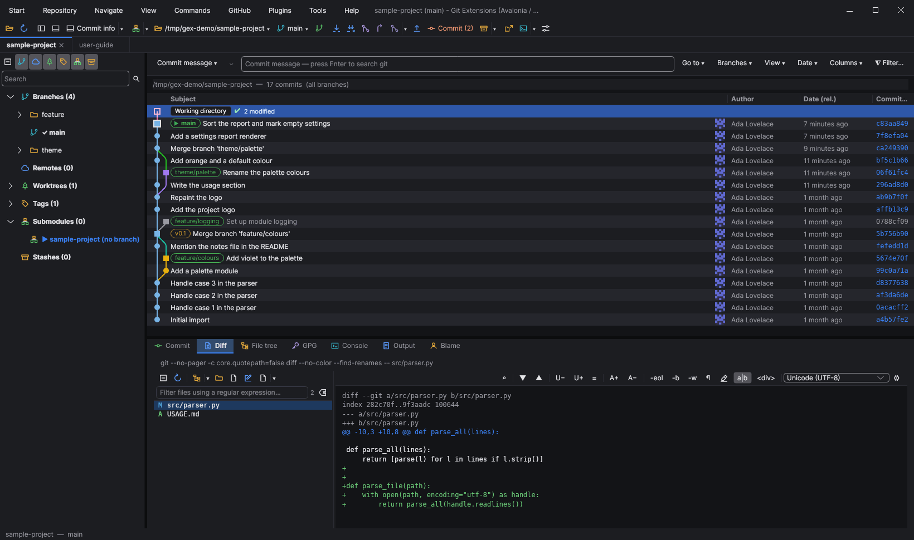

<p align="center">
  
</p>

<h1 align="center">Brencho</h1>

<p align="center"><b>A graphical Git client for Linux, based on Git Extensions.</b><br>
Commit graph, multi-repo tabs, built-in diff and three-way merge, interactive rebase.</p>

Brencho is a port of [Git Extensions](https://github.com/gitextensions/gitextensions),
the Windows Git GUI, to Linux. If you used Git Extensions on Windows and want the
same tool on Ubuntu, Debian or Arch, this is it. It is free and open source
(GPL v3) and a desktop alternative to GitKraken, SmartGit or GitHub Desktop.

The git logic is upstream's, compiled unchanged for plain `net10.0`. The interface
is a new Avalonia UI, because the original is WinForms and WinForms does not run
outside Windows.



## What it adds over the original

- **Several repositories in one window**, on a VS Code-style tab strip: previews,
  pinning, duplicated tabs, submodules and worktrees one click away.
- **Built-in diff, three-way merge and image comparison**, driven by git itself.
  No external merge tool has to be configured.
- **Theme that follows the desktop** (Light / Dark / System), live UI zoom, and
  vector icons coloured by what each command does.
- **An embedded terminal** with a pty of its own, so there is nothing to install.
- **A command palette** (`Ctrl+Shift+P`) built from the real menu.
- **An interactive-rebase todo shown as steps**, and a sequencer bar that tells you
  where a stopped operation is.
- **A `.deb` package** that needs no .NET on the target machine.

## Install (Debian / Ubuntu)

Download `brencho_<version>_amd64.deb` from [Releases](https://github.com/daryda9/Brencho/releases), then:

```bash
sudo apt install ./brencho_*_amd64.deb
brencho /path/to/a/git/repo
```

The package bundles its own .NET runtime; the only dependency is `git`.

## Arch Linux

A `brencho-bin` PKGBUILD is in [`packaging/aur/`](/packaging/aur/).

## Build from source (Linux)

```bash
dotnet build App/GitExtensions.Avalonia.csproj
./run.sh /path/to/a/git/repo
```

## Repository layout

| Path | What it is |
|---|---|
| [`App/`](/App/) | The Avalonia application: views, services, theming, assets |
| [`Core/`](/Core/), [`Compat/`](/Compat/) | Projects that compile upstream's git logic for plain `net10.0`, and the WinForms shims it needs |
| [`Tests/`](/Tests/) | Regression harnesses; `Tests/run-all.sh` builds and runs them all |
| [`packaging/`](/packaging/) | The `.deb` build and the AUR `PKGBUILD` |
| [`docs/`](/docs/) | The [full README](/docs/README.md): every difference from upstream, with screenshots |
| [`ROADMAP.md`](/ROADMAP.md), [`PORTING.md`](/PORTING.md) | Known gaps, and the port's milestone-by-milestone record |
| [`gitextensions/`](/gitextensions/) | Upstream [Git Extensions](https://github.com/gitextensions/gitextensions), unchanged except for three small Linux fixes in its core (listed in `PORTING.md`), kept in sync with it. Brencho compiles its core (`gitextensions/src/app/GitCommands` and friends); the WinForms UI there is not built |

## License

[GPL v3](/LICENSE.md), the same as Git Extensions, from which this is derived. The
`.deb` carries the notices of every bundled third-party component in
`/usr/share/doc/brencho/copyright`.
